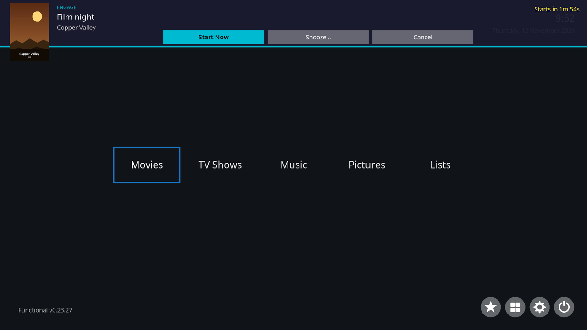
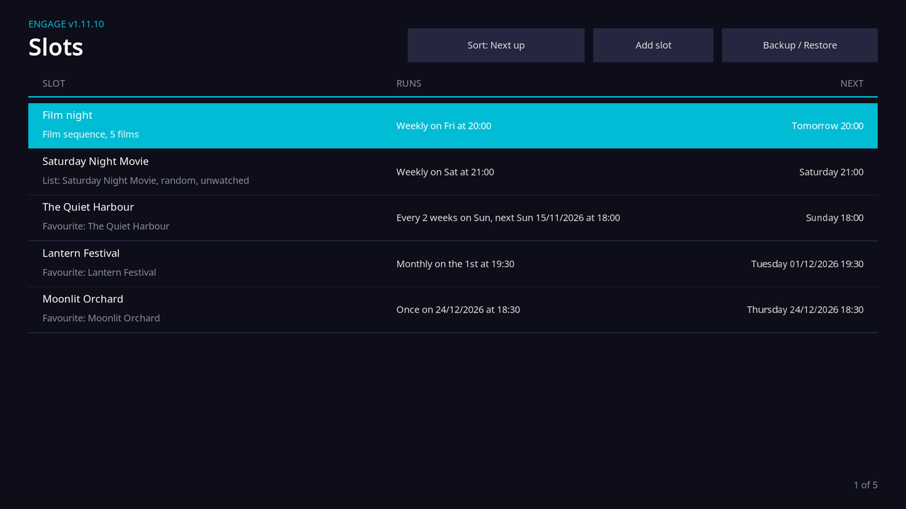
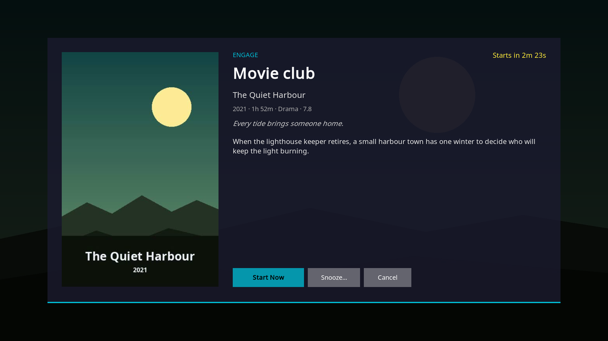

<a href="#quick-start">Quick start</a> · <a href="#what-it-does">Features</a> · <a href="#documentation">Docs</a> · <a href="docs/settings.md">Settings</a> · <a href="docs/skinners.md">Skin properties</a> · <a href="../../releases">Releases</a>

  
  
  
  
  
  

Prompts you with a countdown banner when a weekly watch slot arrives, with the next unwatched episode already chosen, instead of you remembering what to put on.

## Quick start

1. Install the [DeliciousCoffee repository](https://github.com/c0def0rc0ffee/DeliciousCoffee) once, then install Engage from it. Kodi keeps it updated.
2. Or download `service.engage-x.y.z.zip` from [Releases](../../releases), turn on **Settings > System > Add-ons > Unknown sources**, and use **Install from zip file**.
3. Add the show or film to **Kodi Favourites**. For a TV show, favourite the show itself.
4. Open Engage, choose **Manage slots...**, then **Add slot** and **Single show or film**, and pick the favourite, a day and a time.

## What it does

| Feature | In short |
|---|---|
| **Slots** | Weekly, every 2 to 4 weeks, monthly, yearly or once, on several days and times. |
| **Next episode** | Plays the next unwatched episode, specials last. |
| **Movie sequences** | An ordered run of films, next unwatched each time. |
| **Binge orders** | Episodes from several shows woven into one crossover order. |
| **Functional skin lists** | Play a skin list in order, at random or one episode per show. |
| **Banner layouts** | Standard, Thin, Uber thin, Uber thin with no buttons, or Full Monty. |
| **One tap actions** | Start Now, Snooze, Queue Next, Stop & Resume After, Cancel. |
| **Catch up** | Prompts for a missed slot when Kodi comes back, and stays quiet if you watched early. |
| **Backup and restore** | All slots and settings to one JSON file. |

  
  

## Documentation

- [Features in full](docs/features.md)
- [Settings](docs/settings.md)
- [Skin properties](docs/skinners.md) for skin authors
- [Building and source tree](docs/developers.md)

## Licence

[GPL-2.0-or-later](LICENSE)
